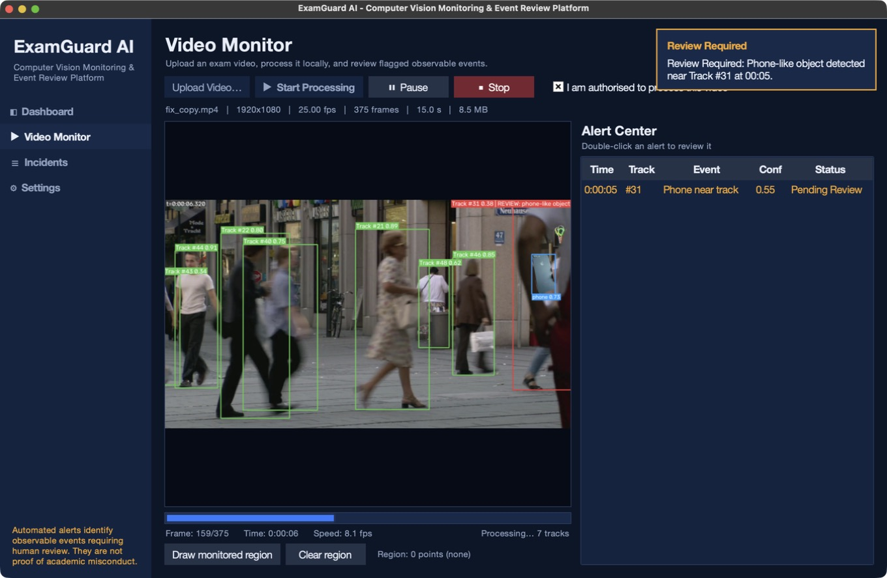
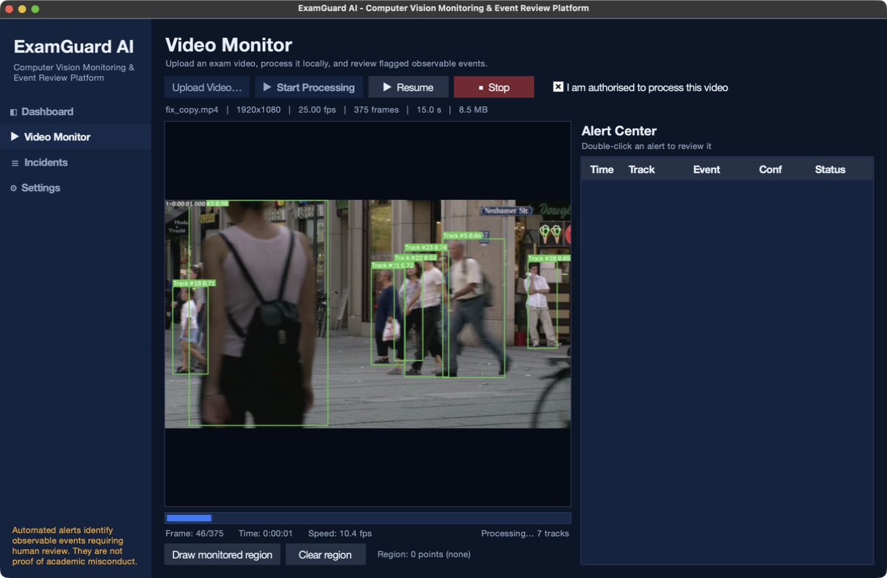
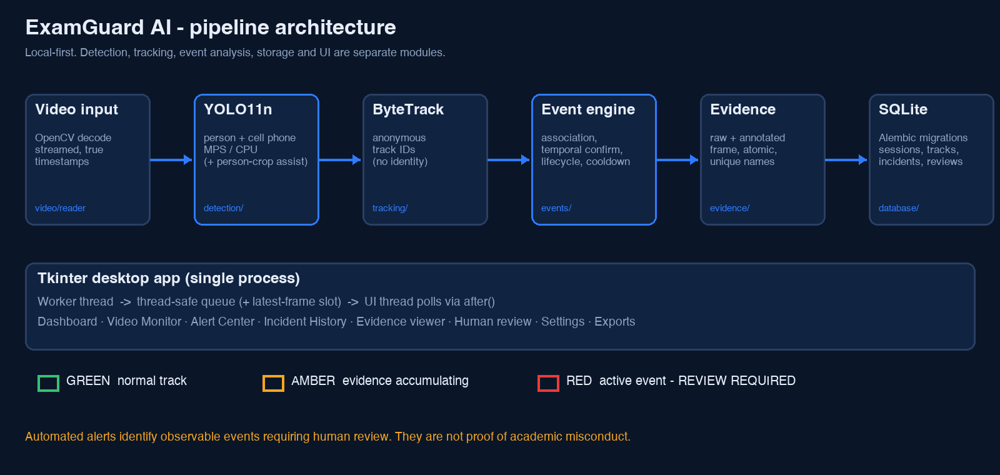
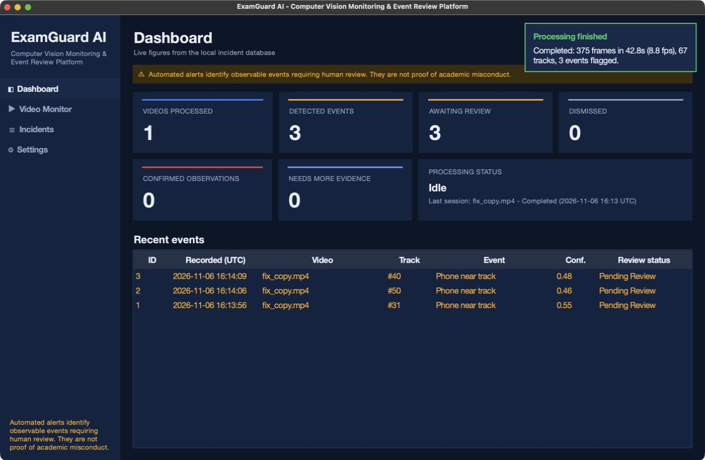
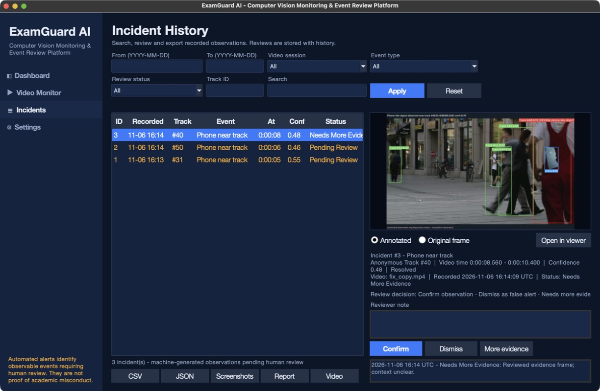
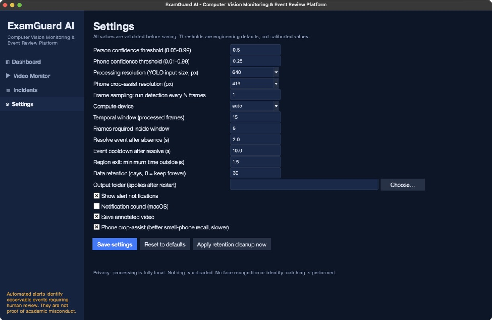
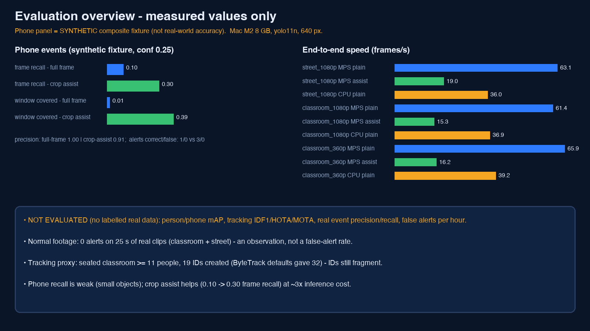

# ExamGuard AI

**Intelligent Exam Monitoring & Suspicious Behavior Analysis Platform** — a local-first Tkinter desktop app that
detects people and phone-like objects in exam videos with YOLO, tracks people with ByteTrack, raises *observable-event*
alerts with screenshot evidence, stores everything in SQLite, and routes every alert to a **human reviewer**.

> **Automated alerts identify observable events requiring human review. They are not proof of academic misconduct.**
> ExamGuard never decides that anyone cheated. It does no face recognition and stores no identities — people are
> temporary, anonymous track numbers.

Built by **Faris Mohamed Kishtah** as Project 3 (Cheating Tracking and Alert System), Sprint 2 of the
INSTANT AI & Data Science training programme.

| | |
|---|---|
|  |  |

*Left: a flagged observable event (RED box, review notification, Alert Center). Right: multi-person tracking (GREEN).
**These frames use a clearly SYNTHETIC test composite** — a real CC0 phone photo pasted into CC0 street footage — see
[Honest status](#honest-status). They are not real footage of phone use.*

## What it does

1. **Upload** a video (mp4/avi/mov/mkv/m4v/webm; 4 GiB cap; corrupt/empty files rejected before anything is stored).
2. **Detect** `person` and `cell phone` with a pretrained **YOLO11n** (MPS on Apple Silicon, CPU fallback).
3. **Track** people with **ByteTrack** → anonymous IDs (`Track #31`).
4. **Analyse events** with explicit rules and temporal confirmation (no single-frame alerts, one incident per
   continuous event, cooldown, started → active → resolved lifecycle).
5. **Show status** on the video: GREEN normal · AMBER evidence accumulating · RED active event.
6. **Capture evidence**: the real frame saved twice (original + annotated), unique names, atomic writes.
7. **Persist** sessions / tracks / incidents / review history in SQLite (Alembic migrations, FK + CHECK constraints).
8. **Notify** with a non-blocking in-app toast (+ optional native macOS banner) and an Alert Center.
9. **Review**: Confirm observation · Dismiss (false alert) · Needs more evidence, with notes and history.
10. **Export** CSV, JSON, screenshots, annotated video (H.264), HTML session report — all labelled as machine-generated.

### Events (observable only)
| Event | Meaning |
|---|---|
| `PHONE_VISIBLE_NEAR_TRACK` | a phone-like object was detected near that tracked person in ≥5 of 15 processed frames |
| `MONITORED_REGION_EXIT` | a track previously inside a user-drawn region has been outside it ≥1.5 s |

Not implemented (no reliable method/data here): gaze, head-turn, whispering, collaboration. See
[docs/EVENT_RULES.md](docs/EVENT_RULES.md).

## Architecture


```
src/examguard/
  detection/  YOLO wrapper, Detection schema, person-crop phone assist
  tracking/   ByteTrack wrapper -> anonymous TrackedPerson
  events/     geometry, association, temporal engine, lifecycle
  video/      streamed reader (true timestamps), annotate, processor
  evidence/   screenshot capture, safe deletion
  database/   SQLAlchemy models, Alembic migrations, repository
  notifications/  alert model, native notifier
  reports/    CSV / JSON / HTML / video export
  ui/         controller (no Tk), worker thread + queue, widgets, views, app
```
The worker never touches Tk: it posts to a thread-safe queue plus a "latest frame" slot that the UI thread polls
(stale preview frames are dropped, never queued). Overlays are stored in *normalised* coordinates, so resizing
the window cannot make boxes or the monitored region drift.

**Database choice:** SQLite, not Firebase. It needs no credentials, cost or network, keeps sensitive exam evidence
on the machine, and is transactional. The assignment suggests Firestore as an option; a cloud store is not required.

## Screens
| Dashboard | Incident history + evidence viewer |
|---|---|
|  |  |
| **Human review** | **Settings** |
|  |  |

## Honest status

* The detector is **generic COCO-pretrained YOLO11n — not fine-tuned for exams.** No custom training was done: no
  authorised labelled exam data exists for this project, so none is claimed.
* **No real, consented, labelled exam-room footage with phone use was available.** Real-world phone-event accuracy is
  **NOT EVALUATED.** The "phone" demonstration is a *synthetic composite* used to test the full pipeline with the real
  model and to compute clearly-labelled fixture metrics.
* **Phone recall is weak** (small object): on the synthetic fixture, frame recall is 0.10 full-frame and 0.30 with
  person-crop assist (precision 1.00 / 0.91); the staged 8 s window was covered 1 % / 39 %. Thresholds were explored
  on that same fixture, so even these numbers are optimistic.
* **IDs fragment**: seated classroom with ≥11 people → 19 IDs created (ByteTrack defaults: 32). Expect ID switches
  after occlusion. IDF1/HOTA/MOTA are **NOT EVALUATED** (no ground-truth identities).
* On real *normal* footage (25 s: classroom + street, no phones) **0 alerts** were produced — an observation, not a
  false-alert rate.

Everything measured is in [docs/EVALUATION.md](docs/EVALUATION.md) and `artifacts/metrics/*.json`.

### Performance (Apple M2, 8 GB, 640 px, measured)
| | MPS plain | MPS + phone crop-assist | CPU plain |
|---|---|---|---|
| 1080p street (375 f) | 63 fps | 19 fps | 36 fps |
| 1080p classroom (620 f) | 61 fps | 15 fps | 37 fps |
Peak process memory 258–898 MB. Video is streamed, never loaded whole. The GUI adds preview/encode overhead (≈8–12 fps
observed live with assist on).



## Install & run (macOS, Apple Silicon)
Use a Python with Tk. The Homebrew Python has no `_tkinter`; **uv's managed Python includes it**.
```bash
git clone https://github.com/fariskishtah/examguard-ai && cd examguard-ai
uv venv --python 3.12 --managed-python .venv && source .venv/bin/activate
uv pip install -r requirements.txt && uv pip install -e .
python scripts/fetch_model.py          # downloads official yolo11n.pt (AGPL-3.0)
python -m examguard                    # launch the desktop app
```
Runtime data lives in `~/Library/Application Support/ExamGuardAI` (override with `--home DIR` or `EXAMGUARD_HOME`).

Try it on openly licensed footage:
```bash
python scripts/fetch_samples.py        # CC0 / CC BY-SA clips from Wikimedia Commons (not redistributed here)
python scripts/make_synthetic_fixture.py data/samples/Video_Codec_Test_pedestrian_area_1080p25.y4m.webm \
       data/fixtures/synthetic_phone_pedestrian.mp4 --start 3 --end 11
python scripts/run_headless.py data/fixtures/synthetic_phone_pedestrian.mp4 --home /tmp/eg-demo   # no GUI
```

### Desktop packaging
```bash
./packaging/build_macos.sh             # -> dist/ExamGuard AI.app (~880 MB with torch)
"dist/ExamGuard AI.app/Contents/MacOS/ExamGuard AI" --selftest some_video.mp4   # drives the real GUI once, prints JSON
```
The bundle was tested as a bundle (repo `models/` hidden, bundled weights and migrations used, real inference, 3
incidents on the fixture). It is **ad-hoc signed, not notarised**: on another Mac, right-click → Open. Windows/Linux
packaging was **not** tested.

## Testing
`pytest` → **82 passed, 0 skipped, 0 failed** (unit, DB/migrations, events, processor with a *scripted fake detector*,
exports, plus 6 integration tests with the real model on real videos and 2 GUI scenarios that include a genuine
process restart). GUI scenarios run in separate processes because Tk 9.0.4 on macOS segfaults when a second `Tk()` root
is created after one was destroyed in the same process; the shipped app creates exactly one root.

## Privacy
Local-first; no uploads, telemetry or cloud DB; no face recognition; authorisation tick-box before processing; data
folder mode 0700; configurable retention with safe deletion (never outside the data folder); videos processed in
place, not copied. Details: [docs/PRIVACY.md](docs/PRIVACY.md). **Only process video you are authorised to process.**

## Limitations
Generic detector; weak small-phone recall; phone↔remote/calculator confusion; ID fragmentation; static-camera
assumption for regions; no gaze/behaviour analysis; sampling (`frame_stride`) trades speed for missed short events;
packaging macOS-only and un-notarised. See [docs/EVALUATION.md](docs/EVALUATION.md).

## Future work
Consented, labelled exam footage → fine-tune a phone/calculator detector with video-level splits and report mAP/IDF1;
appearance-based re-ID *without* identity; calibrated thresholds; optional Firestore sync; notarised builds.

## Licences & data
Code: **AGPL-3.0-or-later** (Ultralytics is AGPL-3.0 — see [docs/LICENSES.md](docs/LICENSES.md)). Sample media and
attribution: [docs/DATA_SOURCES.md](docs/DATA_SOURCES.md) (CC0 pedestrian clip by Taurus Media Technik, CC0 phone photo
by Dennis Cortés; the CC BY-SA classroom clip was used locally only).

## Acknowledgement
Developed as part of the **INSTANT AI & Data Science Training** programme (Sprint 2, Project 3).
